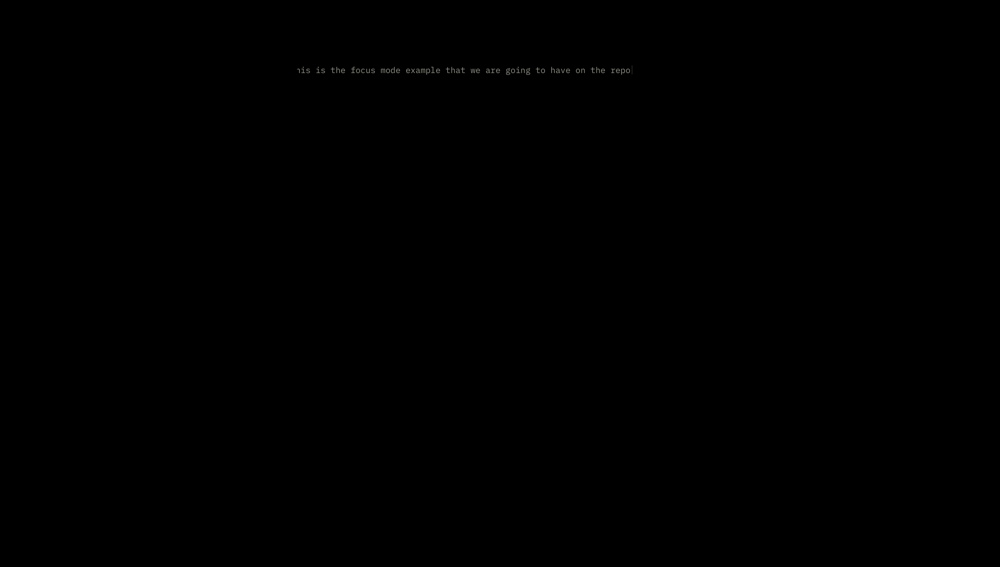

# OmaFreewrite

A focused Markdown writing app for [Omarchy](https://omarchy.org). Write a while
and the whole screen fades to black except one small line of what you just typed,
in the spirit of the [Freewrite Alpha](https://getfreewrite.com/products/alpha): no page to re-read, no cursor to wander,
nothing to fix. Press Escape and the page fades back, and **Polish**, an optional
AI pass, quietly fixes your spelling and breaks the text into short paragraphs
without changing a single word. It runs on your own computer by default, so
nothing you write leaves it.



**Omarchy and Arch Linux, x86_64.** OmaFreewrite is a fork of
[Omawrite](https://github.com/omacom-io/omawrite) and installs beside it with its
own settings, so the two never interfere. Please
[report what you find](https://github.com/TheMarchitect/omafreewrite/issues).

## Inspired by the Freewrite Alpha

OmaFreewrite exists because of the
[**Freewrite Alpha**](https://getfreewrite.com/products/alpha), and it is only a
small software echo of it. The Alpha is a wonderful little machine: a dedicated
drafting device with a full-size mechanical keyboard and a small screen that
shows just a few lines of text. There is no browser, no email and no
notifications to pull you away, and no page of old writing to fiddle with. It
does one thing, getting a first draft out of your head, and it does it
beautifully. When you are done, your drafts sync to the cloud for editing in
whatever you like.

Focus mode here borrows that idea for the desktop, but nothing beats a device
built for it. If OmaFreewrite helps you write, **go get the real thing**. It
weighs 1.6 lb, turns on instantly, and runs about four weeks on a charge at
half an hour a day. It is the best way we know to write without editing
yourself.

👉 [Get the Freewrite Alpha at getfreewrite.com](https://getfreewrite.com/products/alpha)

OmaFreewrite is an independent project and is not affiliated with or endorsed
by Freewrite (Astrohaus). "Freewrite" is their trademark.

## Install

Installing takes two steps: the app, then (if you want Polish) the local AI.

### 1. The app

You need one file: the package whose name ends in **`x86_64.pkg.tar.zst`**, on
the newest [release](https://github.com/TheMarchitect/omafreewrite/releases/latest).

**The quick way:** open a terminal (**Super+Enter** on Omarchy), paste this line,
press Enter and give your password. It downloads the package and installs it in
one go:

```sh
cd /tmp && curl -LO https://github.com/TheMarchitect/omafreewrite/releases/download/v0.2.1/omafreewrite-0.2.1-1-x86_64.pkg.tar.zst && sudo pacman -U omafreewrite-0.2.1-1-x86_64.pkg.tar.zst
```

**Or by hand:**

1. On the [newest release](https://github.com/TheMarchitect/omafreewrite/releases/latest),
   under **Assets**, download the file ending in `x86_64.pkg.tar.zst`. The source
   archives are not needed to install.
2. Open a terminal and install it:

   ```sh
   sudo pacman -U ~/Downloads/omafreewrite-*.pkg.tar.zst
   ```

3. Enter your password when asked and confirm.

Then open **OmaFreewrite** from your application launcher (**Super+Space** on
Omarchy). Its Qt libraries come from the official repositories and install with
it. You do not need to compile anything. If your system has not been updated for
a while, run `sudo pacman -Syu` first.

### 2. Local AI for Polish

Polish needs a language model to talk to. The package includes a one-line setup
that installs [Ollama](https://ollama.com) (the right build for an NVIDIA, AMD or
no graphics card), starts it as a service, downloads Google's Gemma 3 model and
points OmaFreewrite at it:

```sh
omafreewrite-setup-polish
```

That downloads about 3 GB once and works on any machine. If you have a graphics
card with 12 GB or more of memory, the larger model is noticeably better:

```sh
omafreewrite-setup-polish --large      # gemma3:12b, about 8 GB
```

Close OmaFreewrite before running it so it can save the setting. To check it
worked, write past the blackout and press **Escape**: the footer shows
`Polishing…` and then `Polished`.

Prefer a cloud model, or none at all? Skip this step. Polish can use Anthropic,
OpenAI, Groq or any OpenAI-compatible service instead (see [Polish](#polish)), or
be switched off entirely.

## Getting started

1. Open OmaFreewrite and start typing.
2. After fifteen new words the screen fades to black. Keep going. Only letters,
   space, Enter and Backspace work in here. Forward only.
3. Press **Escape** when you come up for air. The page comes back and Polish
   tidies what you just wrote in the background.
4. Press **Ctrl+S** to save. Files are plain `.md`.
5. **Ctrl+Z** undoes a whole Polish pass if you ever want your raw typing back.

The [user guide](USER-GUIDE.md) covers everything in detail. Press **Ctrl+?** in
the app for every key.

## Focus mode

- Once you have typed 15 new words, the window fades to black, goes fullscreen,
  and a single dim line fades in showing the tail of what you are writing. New
  text pushes the old off to the left like a ticker.
- The count is of words written, not words in the file, so opening a long
  document never triggers it. Deleting words lowers the count.
- Arrow keys, Home, End, Page keys and the mouse do nothing.
- **Escape** releases it and runs Polish. **Shift+Escape** releases it without.
  The counter re-arms from there, so the next 15 words bring it back.
- **Ctrl+Shift+F** toggles it by hand at any time.
- **Ctrl+=** and **Ctrl+-** change the line's text size while in the mode.
- **Ctrl+S** keeps working the whole time. If it needs the save dialog, focus
  mode drops first so the picker is not hidden behind the blackout.

The screen is always true black, whatever the system theme.

## Polish

When Escape releases focus mode, Polish sends the words from that session (and
only those) to a language model and asks for exactly two things: spelling,
capitalization and punctuation fixed, and the text broken into short paragraphs
of one complete thought and at most two sentences.

**It never changes your words.** The instructions forbid rewording, adding,
removing or reordering, and the app checks the reply against what you wrote. If
the words drift beyond spelling-level fixes, the reply is thrown away and the
footer says so. Your text stays exactly as it was.

- It runs in the background. Keep typing; if you edit the span before the
  result comes back, the result is dropped rather than applied.
- **Ctrl+Z** undoes a pass in one step.
- The sparkle button in the footer (or **Ctrl+Shift+P**) opens its settings:
  on/off, the server, the model and an optional API key.

**Where it runs:**

| Option | Server | Model | Speed for a few hundred words |
| --- | --- | --- | --- |
| Local, any computer | `http://127.0.0.1:11434` | `omafreewrite-polish` (gemma3:4b) | 20 to 30 s on a laptop CPU |
| Local, 12 GB+ GPU | `http://127.0.0.1:11434` | `omafreewrite-polish` (gemma3:12b) | seconds, on the GPU |
| Anthropic | `https://api.anthropic.com` | `claude-haiku-5-5` | 2 to 3 s |
| OpenAI | `https://api.openai.com/v1` | the cheapest current model | 2 to 3 s |
| Groq | `https://api.groq.com/openai/v1` | any small Llama | 1 to 2 s |
| OpenRouter | `https://openrouter.ai/api/v1` | anything inexpensive | 2 to 3 s |

Cloud services need an API key. Polish is about the simplest job you can give a
model, so the cheapest tier is plenty: a session costs a tiny fraction of a cent.
The key is stored in plain text in the settings file.

Avoid "thinking" models such as Gemma 4 or DeepSeek R1 for now: they reason at
length before answering and Polish times out waiting for them.

## Your files and settings

| Where | What |
| --- | --- |
| Wherever you save them | Your writing (`.md` files) |
| `~/.config/Omacom/omafreewrite.conf` | Settings: font, focus mode, Polish server, model and API key |
| `~/.local/share/Omacom/omafreewrite/` | Draft recovery after a crash |
| `/var/lib/ollama` | Downloaded AI models (owned by the Ollama service) |

Unsaved drafts are recovered after an abnormal exit. OmaFreewrite also watches
open files and warns before an external change can replace your work.

Focus mode has three settings in the config file:

```ini
[focus]
lineFontSize=14   ; pixels, 9 to 40
wordThreshold=15  ; new words before the blackout
autoEnter=true    ; false leaves only the Ctrl+Shift+F toggle
```

## Useful keys

| Key | Action |
| --- | --- |
| `Ctrl+?` | Every key |
| `Ctrl+S` / `Ctrl+Shift+S` / `Ctrl+O` | Save / save as / open |
| `Ctrl+N` / `Ctrl+P` | New window / print |
| `Ctrl+Z` / `Ctrl+Shift+Z` | Undo / redo |
| `Ctrl+F` / `Ctrl+H` | Find / find and replace |
| `Ctrl+B` / `Ctrl+I` / `Ctrl+K` | Bold / italic / link |
| `Super+F` | Fullscreen |
| `Ctrl+Shift+F` | Toggle focus mode |
| `Escape` / `Shift+Escape` | Leave focus mode with / without Polish |
| `Ctrl+=` / `Ctrl+-` | Focus line size |
| `Ctrl+Shift+P` | Polish settings |

The font button in the footer picks any installed font (IBM Plex Mono is the
default), and text follows the desktop text size (`omarchy display text size`).

## What you need

- Omarchy or an up-to-date Arch Linux on an x86_64 computer.
- `xdg-desktop-portal` and a portal backend, for the file picker (Omarchy has
  both).
- For local Polish: about 3 GB of disk for the standard model, or 8 GB for the
  large one. A graphics card makes it much faster but is not required.

## Updating or removing

To update, download the newer package and install it the same way. Your AI
model stays installed.

To remove the app:

```sh
sudo pacman -R omafreewrite
```

Your writing and settings stay where they are; delete the folders in the table
above to remove those too. To remove the local AI as well:

```sh
ollama rm omafreewrite-polish gemma3:4b      # or gemma3:12b
sudo systemctl disable --now ollama
sudo pacman -R ollama ollama-cuda            # or ollama-rocm, or just ollama
```

## Troubleshooting

| The footer says | Do this |
| --- | --- |
| `Polish failed: no server at http://127.0.0.1:11434` | Ollama is not running: `sudo systemctl enable --now ollama`, or run `omafreewrite-setup-polish`. |
| `Polish failed: model "…" not found` | Run `omafreewrite-setup-polish`, or press **Refresh** in the Polish settings and pick a model you have. |
| `Polish failed: the model changed the words, so nothing was touched` | The guard did its job and nothing was touched. Try again, or use a larger model. |
| `Polish failed: the server did not answer with JSON` | Usually a thinking model timing out. Switch to `omafreewrite-polish`. |
| Nothing at all on Escape | Check the switch in the Polish settings is on. Bursts under three words are skipped on purpose. |

More in the [user guide](USER-GUIDE.md#7-troubleshooting).

## Feedback

Please [report a problem](https://github.com/TheMarchitect/omafreewrite/issues)
with your OmaFreewrite version (`pacman -Q omafreewrite`), which model Polish
uses, and the steps that reproduce it.

## Licence

MIT. See [LICENSE](LICENSE). Omawrite, which this is forked from, is MIT too and
its original copyright notice is kept there. The bundled IBM Plex Mono font is
copyright IBM Corp. under the SIL Open Font License 1.1 (`fonts/OFL.txt`). Gemma
models are downloaded by Ollama under
[Google's Gemma terms](https://ai.google.dev/gemma/terms), not shipped with the app.

[Build from source](BUILDING.md).

Copyright © 2026 [Russell Lundstrom](https://marketingplanformula.com) ·
[marketingplanformula.com](https://marketingplanformula.com)
